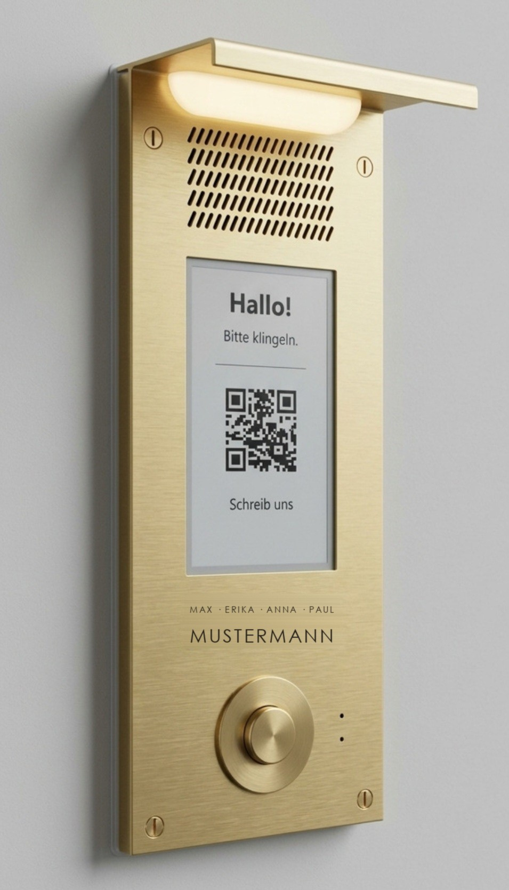
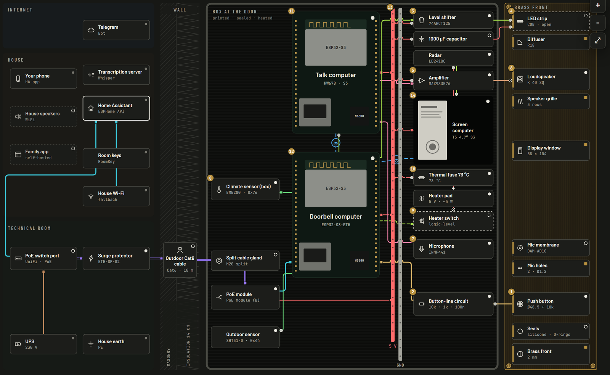

# Klingelbox

**Eine offene Türsprechstelle: Messingfront neben der Tür, E-Paper-Touchscreen, Gegensprechen
mit den Zimmern und ein einziges PoE-Kabel. Gebaut mit ESP32, ESPHome und Home Assistant.
Keine Kamera, niemals.**

[English](README.md)

> Stand: Prototyp. Die ganze Elektronik ist in den gedruckten v3-Kasten gelötet und läuft darin seit
> dem 20.10.2026 auf dem Tisch. Die Metallfront ist noch nicht bestellt, an einer Tür ist noch nichts
> montiert. Stand dieser Seite: 20.10.2026.

  
  &nbsp;&nbsp;
  
   <em>Zielbild: KI-erzeugte Konzeptbilder (Google Gemini), keine Fotos gebauter Geräte. Die gravierten Namen sind
  Platzhalter. Rechts: das Gegenstück in den Zimmern, der <a href="https://github.com/aikos-home/roomkey">RoomKey</a>.
  Beide gehören zu <a href="https://github.com/aikos-home">aikos</a>.</em>

  

## Was es ist

- **Zuerst eine Klingel.** Ein einfacher Messingtaster an einer überwachten Leitung: Ruhe,
  gedrückt und Drahtbruch ergeben drei verschiedene Spannungen. Ein kaputtes Kabel wird gemeldet,
  statt still zu bleiben. Die Meldung ist auf dem Handy, bevor an der Tür irgendetwas anderes passiert.
- **Ein Bildschirm an der Tür.** 4,7-Zoll-E-Paper mit Touch hinter einem Fenster im Messing:
  Begrüßung, Hinweise, QR-Code. Das Bild bleibt ohne Strom stehen und ist in der Sonne lesbar.
- **Sprechen.** Mikrofon und Lautsprecher hinter dem Messing für Gespräche mit den
  [RoomKey](https://github.com/aikos-home/roomkey)-Tasten in den Zimmern; was beide Seiten sagen, steht
  als Text auf dem Bildschirm an der Tür. Geplant: Sprachnachrichten und Push-to-Talk ins Haus.
- **Ein Kabel.** Daten und Strom kommen über ein einziges PoE-Außenkabel. Kein Netzteil an der
  Tür, kein Switch im Kasten.
- **Lokal.** Alles läuft mit ESPHome und Home Assistant im eigenen Haus.
- **Datenschutz eingebaut.** Keine Kamera. Das Mikrofon öffnet erst, wenn jemand an der Tür
  etwas drückt oder drinnen jemand einen Raumschlüssel hält, und der Bildschirm zeigt das an.
  Nichts wird aufgezeichnet.

## Ansehen

Der [Explorer](explorer/) ist eine interaktive Karte des ganzen Systems, auf Deutsch und Englisch:
Leitungsarten ein- und ausblenden, jedes Teil antippen, Rundgänge durch ein Klingeln, den Stromweg,
die Winterheizung und ein Gespräch. [`explorer/dist/klingelbox-explorer.html`](explorer/dist/klingelbox-explorer.html)
herunterladen und im Browser öffnen. Eine gehostete Version ist geplant.

## Wie es funktioniert

Drei kleine Rechner teilen sich ein Kabel und eine 5-V-Schiene. Nur der Klingelrechner hängt am Kabel; er
spannt für die anderen beiden ein eigenes WLAN auf und verbindet es mit dem Hausnetz.

| Rechner | Platine | Verbindung | Aufgabe |
|---|---|---|---|
| Klingel | Waveshare ESP32-S3-ETH + PoE Module (B) | Kabel | Klingelleitung, Klimasensoren, WLAN und 5 V für den Kasten; später Heizung und Licht |
| Sprechen | ESP32-S3-N16R8-Entwicklerplatine („HW678“) | WLAN | Mikrofon, Verstärker, Gespräche |
| Bildschirm | LilyGO T5-4.7-S3 Touch | WLAN | E-Paper-Touchscreen; später das Radar |

Die Klingel läuft auf einer eigenen Platine. Ein Absturz oder ein Update im Audiocode kann sie deshalb nie stumm
schalten. Details, Strom, Winterheizung und Kasten stehen in [docs/architecture.md](docs/architecture.md) (Englisch).

## Inhalt

| Pfad | Was |
|---|---|
| [`docs/architecture.md`](docs/architecture.md) | Aufbau, Strom, Winter, Sprechen, Mechanik |
| [`docs/bom.md`](docs/bom.md) | Einkaufsliste mit den Fallen (falsche „Touch“-Angebote, Kabel mit Aluminiumkern) |
| [`docs/roadmap.md`](docs/roadmap.md) | die Meilensteine vom Tisch bis zur Tür und die offenen Entscheidungen (Englisch) |
| [`docs/build-log.md`](docs/build-log.md) | was bisher passiert ist, auch die Sackgassen |
| [`docs/family-app.md`](docs/family-app.md) | die geplante selbst gehostete App für den Haushalt |
| [`hardware/`](hardware/) | der v3-Kasten mit allen Druckteilen, die Druck- und Einbauanleitung, die Front, Maßzeichnungen der Teile |
| [`explorer/`](explorer/) | die interaktive Karte und ihr Build |
| [`firmware/`](firmware/) | ESPHome-Firmware für alle drei Rechner: [Klingel](firmware/bell/), [Sprechen](firmware/talk_computer/), Bildschirm (Englisch) |
| [`firmware/WIRING.md`](firmware/WIRING.md) | wie alles im Kasten verdrahtet ist, Ader für Ader, mit den Lötblättern (Englisch, Blätter deutsch) |
| [`docs/screen-ux.md`](docs/screen-ux.md) | was der Bildschirm an der Tür zeigen kann und was nicht, am Panel getestet (Englisch) |
| [`tools/`](tools/) | der Datenschutz-Scan vor jedem Push und Testskripte für den Labortisch |

Die Home-Assistant-Automationen sind noch nicht in diesem Repo.

## Sicherheit

- Der Überspannungsschutz schützt nur geerdet. Das und alles an 230 V ist Sache eines Elektrikers.
- Das E-Paper-Panel ist für 0 bis +50 °C freigegeben. Draußen braucht es die Heizung, und die
  Heizung braucht ihre Thermosicherung.
- Vor jedem Griff an eine Leitung im Kasten den PoE-Port ausschalten.
- Nie den USB-Anschluss einer Platine an einen Computer stecken, solange die 5-V-Schiene im
  Kasten Strom hat, außer das Kabel sperrt die Versorgung.

## Lizenzen

- Code (Skripte, Explorer, Firmware): [MIT](LICENSE), außer dem Bildschirmtreiber in
  `firmware/components/lilygo_t5_47_plus/`, der seine Lizenz behält (GPLv3 für C/C++)
- Hardware (CAD-Skripte, STL, STEP, Zeichnungen): [CERN-OHL-P-2.0](LICENSES/CERN-OHL-P-2.0.txt)
- Dokumentation und Bilder: [CC BY 4.0](LICENSES/CC-BY-4.0.txt)

Entworfen und geschrieben mit [Claude Code](https://claude.com/claude-code).
