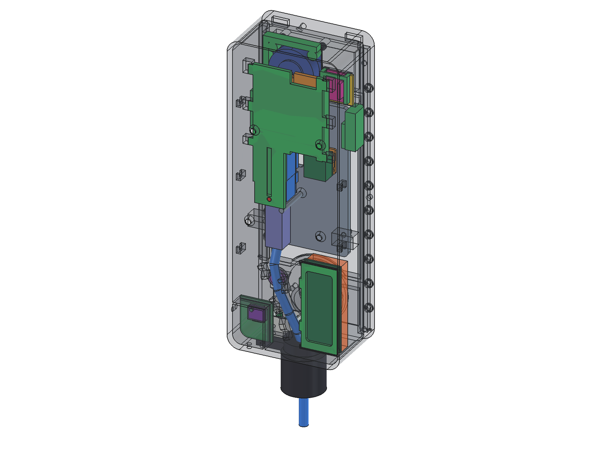

# Box v3: the prototype box with all the electronics inside

State: **v3.7**, 17 October 2026. This is the box the whole intercom is built into and runs in on the desk (since
20 October 2026). It is a printed prototype: the front's steel and brass sheets are printed stand-ins of the same
shape, and the metal is **not ordered yet**. The final box (v4) will have no glued parts.



| Folder / file | What |
|---|---|
| [`DRUCKEN.md`](DRUCKEN.md) | the complete print and assembly guide, step by step (German) |
| [`print/`](print/) | 20 STL files, already in print orientation |
| [`metal/`](metal/) | templates for a metal shop: steel sheet (STEP + DXF contour), counter-strips (DXF), brass (STEP), diffuser (STEP), and the steel notes `STAHL_VORLAGE.md`. **Do not order yet** |
| [`images/`](images/) | renders of the box, the speaker mount, the radar frame, the climate chamber lid and more |
| [`cad/`](cad/) | the FreeCAD generators: one parameter file, one script per part group, the build-check-export chain |

## The box in short

- 92 × 252 × 60 mm, PETG, surface-mounted on the solid wooden door frame with four countersunk wood screws.
- **Front:** a steel sheet with the display window, screwed with 18 M3 screws (an O-ring under each) into two
  counter-strips that are laid into the box during a print pause; the brass sheet sits on top with four screws. A
  white diffuser under the brass roof will carry the light.
- **Inside, front to back:** the display on a carrier plate (two tongues at the top, two screws at the bottom, the
  amplifier on its back), then one carrier for the doorbell and talk computers that runs in rails on the back wall and
  slides out downwards, and the distribution board on a clip socket at the bottom left.
- **Grille block** at the top: the speaker is clamped from the front into a clamp ring with a foam rubber gasket; the
  radar sits in a glued frame behind the grille.
- **Bottom:** the brass button, the microphone pocket with a membrane, a separate chamber for the outdoor climate
  sensor (three small openings to the outside), a potted field of three service USB-C breakouts, and a split M20 cable
  gland through which the cable passes with its plug. The cable is tied along five eyelets in an S-curve.

## Parts

| No | File | Part | Notes |
|---|---|---|---|
| 01 | `01_kasten.stl` | box | back wall down, with a **print pause** (see below) |
| 02 | `02_display_traegerplatte.stl` | display carrier plate | front: the press pins; back: the amplifier |
| 03 | `03_computer_traeger.stl` | carrier for the doorbell and talk computers | snaps in with a glued knob (06c) |
| 04 | `04_lautsprecher_klemmring.stl` | speaker clamp ring | 2 heat-set inserts |
| 05 | `05_radar_rahmen.stl` | radar frame | glued in with hot glue |
| 06 | `06_verstaerker_rahmen_3_staerken.stl` | amplifier frame, set of 3 pin sizes (Ø2.5 / 2.6 / 2.7) | take the one the board sits tight on; the prototype: 2.6 |
| 06b | `06b_zapfen_4x_abknipsen.stl` | dowels for the amplifier frame | 2 needed, 2 spare |
| 06c | `06c_rastknoepfe_3_hoehen.stl` | snap knobs for the carrier (0.4 / 0.6 / 0.8 mm) | one is glued to the back wall |
| 07 | `07_verteiler_sockel.stl` | clip socket for the distribution board | glued into its seat |
| 08 | `08_sht31_kammerdeckel_3_staerken.stl` | lid of the climate chamber, set of 3 pin sizes (Ø3.0 / 3.1 / 3.2) | the prototype: 3.2 |
| 09 | `09_display_druckstifte_4_laengen.stl` | display press pins in 4 lengths | −1.5 fits |
| 10 | `10_gegenleisten_ersatz_fuer_druckpause.stl` | counter-strips, 231 and 191 mm | printed stand-ins for stainless steel, for the print pause |
| 11 | `11_usb_einsatz.stl` | USB insert | holds and pots the three breakouts |
| 12 | `12_usb_abdeckung.stl` | USB cover | 2 × M3 security Torx |
| 13 | `13_stahlblech_ersatz.stl` | steel sheet stand-in | |
| 14 | `14_messing_ersatz_unten.stl` | brass stand-in, lower part | carries the engraving (placeholder names) |
| 15 | `15_messing_ersatz_oben.stl` | brass stand-in, upper part with the roof | |
| 16 | `16_diffusor_weiss.stl` | diffuser under the roof | white PLA |
| 17 | `17_plattenstuetzen_links_rechts.stl` | two supports for the display plate | glued to the side walls |
| 18 | `18_display_abstandsstuecke_3_staerken.stl` | spacer combs (2.6 / 2.7 / 2.8 mm) for the gap between the e-paper panel and its board | broken off and glued in |

## Printing

Tested on a Bambu Lab A1, 0.4 mm nozzle, textured PEI, 0.20 mm layers. The box gets 4 walls and 25 % gyroid infill,
the other parts 3 walls, the diffuser 2. Everything is PETG except the diffuser (white PLA). The box takes about
11.5 hours and 271 g of filament, all other parts together about 8.5 hours and 170 g.

**The print pause:** the box prints with its back wall on the bed. At 54.0 mm (88 %) the printer pauses; the two
counter-strips (part 10, 231 and 191 mm) are pressed into their open channels, and the collar is printed over them.
They stay in the box for good. On a Bambu printer, start the sliced file **at the printer**, not from Bambu Studio:
Studio re-slices on sending and the pause is lost.

Support goes inside the box (behind the grille block, in the radar pocket, along both sides, around the button and the
microphone, under the eyelets) and outside into the four screw holes. Clean the radar pocket thoroughly. The details,
and what to check after the print, are in [`DRUCKEN.md`](DRUCKEN.md).

## Assembly, in order

1. Melt in the 8 heat-set inserts.
2. Glue the distribution board's socket, the two plate supports and the climate chamber lid (with the SHT31 on its
   pin, wires through the lid's hole, sealed with silicone).
3. Solder and pot the USB field.
4. Fit the speaker from the inside with its gasket and clamp ring; two screws from the front.
5. Glue the radar frame into its pocket behind the grille.
6. Mount the box on the door frame (cable through the split gland first).
7. Put the doorbell and talk computers on the carrier and slide it up until it snaps in; plug the LAN cable and tie it
   along the eyelets.
8. Press the distribution board onto its socket.
9. Prepare the display plate (amplifier frame, amplifier, press pins) and hang it in; two screws at the bottom.
10. Microphone with membrane and gaskets, button with its O-ring.
11. Put the display on the pins; spacer pieces into the gap behind the panel.
12. LED strip under the roof (later).
13. Steel sheet with 18 screws and O-rings, then the brass and the diffuser.

The wiring that goes with steps 7–11: [`firmware/WIRING.md`](../../firmware/WIRING.md).

## What changed from v2, and in v3.x

| | v2 | v3 |
|---|---|---|
| Counter-strips | pushed in from the top, channels full of support | laid into open channels in a print pause, the collar printed over them; an O-ring at every screw |
| Speaker | inserts at the back of the grille block, hard to reach | two screws from the front into a clamp ring, foam rubber gasket |
| Radar | carrier with a back plate, shaft too tight | spacer frame, glued in |
| Computers | sleds on rails, doorbell computer on the plate | one carrier in rails on the back wall, slides out downwards |
| Display plate | 4 screws, carries the doorbell computer | hangs on 2 tongues, 2 screws; carries the press pins and the amplifier |
| Distribution board | holder for 25 × 70 | a whole 30 × 70 board on a glued clip socket |
| Cable | M20 hole, no gland | split M20 gland, the plug fits through; 5 eyelets in an S-curve |
| Climate sensor | BME280 in a holder | SHT31-D in its own outdoor chamber; the BME280 moves onto the distribution board |
| Light | 2 windows in the collar | a COB strip in the diffuser under the roof, one cable hole |

Every v3.x step fixed a finding on the printed part: v3.1 a pin for the measured SHT31 board, v3.2 a spacer frame for
the radar (its header is on a long side), v3.3 a snap knob for the carrier (without the plate it slid out), v3.4 a glued
radar frame (it could not be pressed in), v3.5 pin sets in three sizes (printed pins come out about 0.1 mm thin), v3.6
supports for the display plate (it bent back when pressed), v3.7 spacers behind the e-paper panel (it gave way when
pressed). The box itself is the same file from v3 to v3.7.

## Rebuild

Everything is generated from [`cad/v3_params.py`](cad/v3_params.py), with FreeCAD 1.1's command-line interpreter:

```
cd hardware/v3/cad
freecadcmd tools/v3_alles.py
```

It runs, and stops at the first failure: `validate()` on the parameters, `check_cad()` on the built box,
`check_teile()` on every printed part and the assembly paths (strips in the pause, carrier in and up, plate in), its own
checks for the brass, the steel, the diffuser and the USB field, and an overlap test between them; then it exports
everything into `cad/out/`. `tools/v3_mutationen.py` builds 18 deliberately broken variants and confirms that every
one is caught. If `__file__` is not set in your FreeCAD, set the environment variable `KLINGELBOX_V3_DIR` to the `cad`
folder.

The STL files in `print/` were built this way from these scripts on 20 October 2026. Apart from the lower brass part,
they are byte-identical to the files the prototype was printed from.

- **Engraving:** the brass reads the glyph outlines from
  [`../front-sheet/layout-v5-bemasst.svg`](../front-sheet/layout-v5-bemasst.svg), which carries the placeholder
  names **MAX · ERIKA · ANNA · PAUL / MUSTERMANN**. To engrave your own, change `NAMES` and `FAMILY` in
  `front-sheet/make_layout_v5.py`, run it, and rebuild.
- **Fonts:** the part labels use Arial Bold from `C:/Windows/Fonts/arialbd.ttf` (`v3_teile.py`, `v3_diffusor.py`);
  change the path on other systems.
- The comments in the scripts are German, as the project was designed in German.
